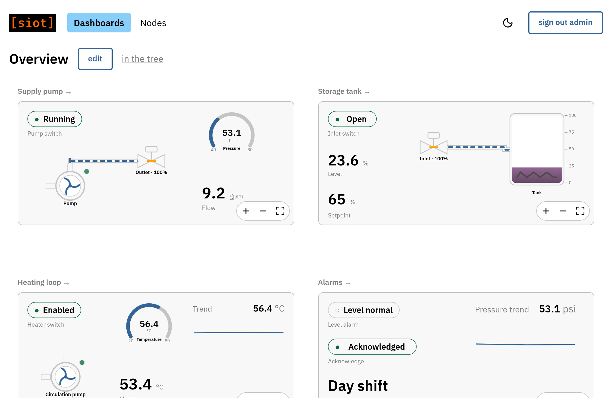

# Dashboards

A dashboard shows live values from any nodes on one page: a tank level as a
gauge, a pump as a status pill, a temperature as a trend. It is built from
nodes, so it syncs between instances, follows the same permissions as the nodes
it shows, and can be created by a script or an agent through the same API as
everything else.



Open **Dashboards** in the header to see the dashboards you can reach, and open
one to view it. On a phone the grid becomes a single column. Tap a widget to
open the node behind it: a dialog on a wide screen, the node's page in the tree
on a narrow one.

## Building one

1. In **Nodes**, add a **Dashboard** under a device or group and give it a
   description. Open its details for an **open** link to the dashboard page.
2. On the dashboard page, press **edit**. **add widget** places a new widget
   below the others and opens its settings beside the grid. Pick the node it
   reads by typing its description in the node field, then the point type and
   key if the default `value` is not what you want. Drag a widget by its body to
   move it and by any corner to resize it; the place is saved when you let go.
   Press **done** to leave edit mode. The address follows the selected widget,
   `/dash/<dashboard>/<widget>`, so a link opens that widget's settings. A
   widget's settings also offer **duplicate**, which adds a copy with the same
   bindings and options and opens it, and **copy**, which puts the widget on the
   clipboard; **paste** then adds a copy of it to any dashboard in edit mode,
   this one or another.
3. Leave the component on **auto** to show the node the usual way for its type,
   or pick one:

   | Component | Shows                       | Options                                        |
   | --------- | --------------------------- | ---------------------------------------------- |
   | value     | the number or text, large   | `decimals`, `unit`, `multiplier`, `confirm`    |
   | gauge     | a radial gauge over a range | `min`, `max`, `unit`, `decimals`, `multiplier` |
   | status    | on or off                   | `on`, `off`, `confirm`                         |
   | trend     | the last values as a line   | `window`, `min`, `max`, `unit`, `multiplier`   |
   | slider    | a setting over a range      | `min`, `max`, `step`, `unit`, `decimals`       |

4. A dashboard has 12 columns unless its **Columns** setting says otherwise. The
   column, row, width, and height fields in the widget's settings set its place
   in grid units when dragging is not convenient.
5. Add options under **Options**, keyed by the names in the table. Every widget
   also takes `scale`: `2` draws it at twice the size, for a reading that should
   carry across a room, and `0.5` at half. `multiplier` scales the reading
   itself, for a point whose unit is not the one to show: an uptime in seconds
   reads in days with `multiplier` `0.0000115741` and `unit` `d`, and a memory
   figure in bytes reads in megabytes with `0.000001`. `min` and `max` are in
   the shown unit, and a value edited as a setting is scaled back before it is
   sent. `background` draws a card behind the widget: `on` for the page's card
   color, or a CSS color such as `#ffffffcc`. A value placed over a tank or a
   drawing then reads cleanly.

Widgets are nodes under the dashboard, so everything above can also be done in
the node tree, by a script, or by an agent.

## Canvas layouts

Set a dashboard's **Layout** to **canvas** for a process mimic: a plane of
**Canvas width** by **Canvas height** units (900 by 500 unless set), scaled to
fit the page. Zoom with the buttons in the corner or with ctrl and the mouse
wheel, then drag the background to pan; the **Fit** button returns to the whole
drawing. A canvas stays a canvas on a phone, scaled to fit the width, and the
page scrolls past it until it is zoomed in.

Equipment components draw on the canvas:

| Component | Shows                                      | Bindings           |
| --------- | ------------------------------------------ | ------------------ |
| tank      | liquid at the level, tinted by temperature | `level`, `temp`    |
| pump      | an impeller that turns while running       | `running`, `speed` |
| valve     | a disc that turns with the position        | `open`             |

The grid widgets work on a canvas as well. **X**, **Y**, and **Width** are in
canvas units there. In edit mode, drag the corner of a widget to set its width,
which is the size the equipment draws at.

Widgets on a canvas can overlap. **Z** sets which one is on top: a higher Z
draws over a lower one, and widgets with the same Z draw in ID order. A new
widget goes on top. In edit mode, **bring to front**, **forward**,
**backward**, and **send to back** above the selected widget's settings change
its place in the stack, and a click selects the topmost widget under the
pointer. Links draw over widgets with a negative Z, such as a background image,
and under the rest.

Links join two widgets at their **ports**, the named points on a widget's edge
that show as dots in edit mode. Drag from one port to another to draw a link. A
link's **From** and **To** are `widget.port`, where the widget is named by its
ID or by its description. Select a link to drag its corner points and to set its
routing, direct or orthogonal, in the panel. A link's `flowing` and `rate`
bindings animate it, and a link whose bound node is missing is drawn dashed and
dim. Links are drawn, not run: a pipe from a pump to a tank describes the plant
and implies nothing about where data goes.

A widget's ports can be changed under **Ports**: `x,y` or `x,y,dir` as fractions
of the widget's box, where `dir` is `left`, `right`, `up`, or `down`.

A widget whose node cannot be found draws with a dashed border and shows no
value. A dashboard synced to a device that lacks some of the nodes still shows
its shape.

## Controls

A widget bound to a node that accepts a new value is a control. A status pill on
an on/off variable is a switch: click it to flip the state. A value tile on a
number or text variable is a setting: click the value for an edit box, and Enter
sends it. A slider sends its value when it is let go. A click anywhere else on a
dashboard does nothing; the node behind a widget is reached through edit mode,
where the widget's settings link to it.

Which nodes accept writes, and on which point, is part of each node type: a
variable takes the value itself, and an output such as a Modbus IO or a GPIO
takes a set request. Set the `control` option to `off` on a widget that should
only show, and `confirm` to `on` for one whose change must be confirmed before
it is sent.

A node with many settings under their own point types, such as an MCU on a
serial link, takes none of them by default. Set the `write` option to the point
type a widget should send, and the widget writes that type under its binding's
key, whatever the node. A slider bound to an MCU's `fanSet` point with `write`
set to `fanSet` is a fan speed setting. A number goes out as an integer when the
point already holds one, or when the widget's `integer` option is `on`. Set
`integer` for an MCU setting the firmware reads as an integer, since a point the
MCU only receives holds whatever type was last written to it. `write` applies to
every binding the widget has, so give it to a widget that binds only what it
should set.

## Custom drawings

The **svg** component draws an SVG you upload, with elements inside it following
live points: a lamp, a dial, a vessel, a panel face, or a whole site plan from
Inkscape or draw.io.

1. In **Nodes**, add a **File** node under the group and upload the SVG with the
   **Binary** option off. **Edit contents** opens it in a code editor, so the
   attributes below can be added there, or a small drawing written in place.
2. The file node's settings show the drawing, with a test value for each binding
   it declares. Type a value, or click an element marked `toggle` or `set`, to
   see the drawing respond; nothing is sent.
3. On the dashboard, add a widget, pick the **svg** component, and pick the file
   node as the **svg node**. The editor then lists every binding the drawing
   declares, named as the drawing names it and with what the drawing does with
   it, and each one is bound to a node like any other.

A drawing declares what follows a point with `data-siot-*` attributes on its
elements. Add them in a text editor or in the drawing tool's XML editor; nothing
else in the file changes.

| Attribute                     | On an element                                                                                                             |
| ----------------------------- | ------------------------------------------------------------------------------------------------------------------------- |
| `data-siot-bind="name"`       | names the binding the element follows                                                                                     |
| `data-siot-text`              | replaces the element's text with the value                                                                                |
| `data-siot-decimals="1"`      | decimals for the text; `data-siot-unit` is appended as given                                                              |
| `data-siot-range="0,100"`     | the value range `rotate` and `level` map from; 0 to 100 when absent                                                       |
| `data-siot-rotate="-90,90"`   | turns from the first angle at the range's low end to the second at its high end                                           |
| `data-siot-level`             | scales the element's height by the value over the range, from the bottom                                                  |
| `data-siot-translate="600,0"` | moves the element from where it is drawn by up to that many drawing units, x then y, across the range                     |
| `data-siot-bands="25,50"`     | sets `data-siot-band` to how many of the thresholds the value is at or above (`0`, `1`, or `2` here), for CSS to color by |
| `data-siot-origin="50% 100%"` | where the element turns or scales about; the center, or the bottom for a level, when absent                               |
| `data-siot-port="name,dir"`   | makes the element's center a port for links; `dir` is `left`, `right`, `up`, or `down`                                    |
| `data-siot-toggle`            | a click sends the opposite of the bound value                                                                             |
| `data-siot-set="1"`           | a click sends that value, as text when it is not a number                                                                 |
| `data-siot-open`              | a click opens the dashboard the binding names; see [opening another dashboard](#opening-another-dashboard)                |

Every bound element also gets a `data-siot-state` attribute of `on`, `off`,
`stale`, or `dead`: `on` when the value is not zero, `stale` while the point has
not arrived, and `dead` when the node cannot be found. The drawing's own
`<style>` does the rest, so a lamp lights with
`.glass[data-siot-state="on"] { fill: #ffd54a }` and a dead element can hide
itself. Thresholds work the same way: a battery bar with
`data-siot-bands="25,50"` turns red below 25 with
`.charge[data-siot-band="0"] { fill: #dc2626 }`, and has no band while its value
is stale or missing. An element without a `data-siot-bind` follows the nearest
ancestor's, so a group bound once can hold a start and a stop button with
`data-siot-set` of `1` and `0`. A text element shows the point's text when it
has one and the number otherwise; attribute values are trimmed, so draw a space
before a unit as a separate `tspan` rather than in `data-siot-unit`.

An element follows one binding, so a marker that moves both ways on a map is two
nested groups, one for each axis. Here the rover is drawn at the map's origin,
moves 600 units right as `x` goes from 0 to 60 m and 300 units up as `y` does,
and turns with its heading:

```xml
<g data-siot-bind="x" data-siot-translate="600,0" data-siot-range="0,60">
  <g data-siot-bind="y" data-siot-translate="0,-300" data-siot-range="0,60">
    <path d="M-8,-6 L10,0 L-8,6 z" data-siot-bind="heading"
      data-siot-rotate="0,360" data-siot-range="0,360" />
  </g>
</g>
```

A click on an element with `toggle` or `set` sends a value when the binding it
follows accepts writes, as the [controls](#controls) above do, and `confirm` and
`control` apply. Ports declared in the drawing are where links attach on a
canvas, computed from the element's `cx`/`cy` or `x`/`y`/`width`/`height`
attributes; a `port.*` point on the widget overrides one of the same name.

Every drawing is sanitized before it reaches the page: scripts, event handlers,
links, embedded documents, and references outside the file are removed, and
local styles, gradients, and inline images are kept. A file that is not an SVG,
or has neither a `viewBox` nor a size, draws as a placeholder saying so.

`testdata/custom-widget-demo.yaml` shows every feature on two dashboards, with
the drawings written inline; see [A demo](#a-demo).

## Images

The **image** component shows a picture from a file node: a site photo, a panel,
a logo. Upload a PNG, JPEG, GIF, or WebP to a **File** node with the **Binary**
option on, or an SVG either way, then bind the widget's `image` to the file
node. On a canvas the image takes the widget's width at its own proportions; give
it a negative Z to use it as a background under the links and the equipment. In a grid tile `fit` says
how it fills the tile: `contain` (the default), `cover`, or `stretch`. `opacity`
from `0` to `1` fades it. An SVG is sanitized as a [drawing](#custom-drawings)
is, and its bindings are not followed; use the **svg** component for that.

## Relative bindings

A binding usually names one node. It can instead name a path from the
dashboard's parent: `type/description` segments, such as `modbusIo/pump1` or
`device/Station A/modbusIo/pump1`, each picking a child of the node before it by
type and description. A dashboard with relative bindings placed under several
devices, by mirroring it, shows each device's own nodes. In a widget's settings,
after picking a node that sits below the dashboard's parent, press **make
relative to** that parent; **absolute** goes back to the node ID. A path that
reaches nothing draws the widget dead.

Which parent the paths start from comes with the address, as `?via=<node ID>`.
The tree's **open** link and the dashboard list fill it in with the place the
dashboard was reached through, and a nested dashboard's title link with the
parent it was drawn under, so a mirrored dashboard opened from any of them shows
that place's nodes. An address without it starts from the first place the
dashboard is found in, so a bookmark to a mirrored dashboard should keep the
`via`.

## Nested dashboards

The **nested dashboard** component shows another dashboard inside a widget: bind
its `dashboard` to the dashboard node. A dashboard that contains itself, at any
depth, stops there with a note. Relative bindings in the nested dashboard start
from the parent the outer dashboard was opened under, so an overview mirrored
under several devices shows each device's nodes in every tile, and the
dashboards it shows need no mirroring of their own.

## Opening another dashboard

Any widget can open another dashboard when clicked, for moving between the
screens of an HMI: an overview with a reading or a tank per area, and each area
with a way back. Bind the widget's `navigate` to the dashboard node. A click
where the widget acts on its own, such as editing a value or a `toggle` in a
drawing, still does that; a click anywhere else opens the dashboard. The
dashboard opens under the same parent as the one it was opened from, so its
relative bindings follow the same device.

The **button** component is a label for this: it shows the `text` option, else
the widget's description, else the dashboard's.

In a [custom drawing](#custom-drawings), `data-siot-open` on an element opens
the dashboard its binding names, so each region of a site plan can open the
dashboard for that area:

```xml
<g data-siot-bind="north" data-siot-open>
  <rect x="0" y="0" width="200" height="120" />
</g>
```

Bind `north` to a dashboard in the widget's settings. In edit mode a click
selects the widget rather than opening a dashboard. `testdata/links-demo.yaml`
shows each of these, and a button that keeps the station it was opened under.

## Home dashboard

A user's **Home dashboard**, set on the user's node, is where signing in and the
logo link land. Picking it also fills in **Home dashboard under**, the place it
was found in, which is where its relative bindings start; change that to open a
mirrored dashboard in another place. A user without a home dashboard lands on
the dashboard list when any dashboard is visible to them, and on the node tree
otherwise.

## What a widget does not do

Widgets display; they never compute. Scaling, unit conversion, aggregation, and
events belong in the node that produces the point, or in a [rule](rules.md), so
the result is also available to notifications, the database, and other
dashboards, and keeps working when no browser is open. A widget may format what
it shows: decimals, units, a gauge range.

## Kiosk

Add `?kiosk` to a dashboard's address to hide the header and title for a wall
display.

## A demo

`testdata/dashboard-demo.yaml` in the source tree builds a small water system
under one group: a supply pump, a storage tank, a heating loop, and an alarm
panel, each on its own canvas, and an Overview that shows the four canvases as
tiles. Rules make the switches do something: the pump switch starts the flow and
pressure signals and opens the outlet valve, the inlet switch opens the inlet
valve and runs the tank level, the heater switch runs the temperatures, and a
high tank level raises an alarm that asks to be acknowledged. Load it into a
running instance with:

```
siot import < testdata/dashboard-demo.yaml
```

The file is also a worked example of writing dashboards by hand: widget bindings
name nodes by description, and link ends name widgets by description.

`testdata/custom-widget-demo.yaml` does the same for
[custom drawings](#custom-drawings): five SVGs as file nodes, a canvas and a
grid that place them, a stale and a dead binding on purpose, and a panel bound
by path under two stations. The comment at the top says where each feature is.

`testdata/layers-demo.yaml` shows [images](#images), stacking, and widget
backgrounds: a site plan behind a pump and a tank, readings on cards over the
tank, two overlapping cards to try the stacking buttons on, and a grid of image
tiles with each `fit`. The comment at the top says where each feature is.

## Coming later

Trends over stored history.
