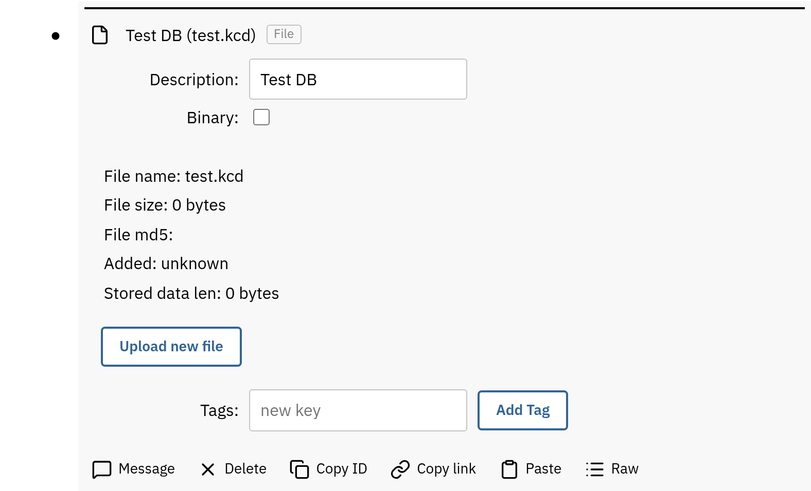

# File

The file node can be used to store files that are then used by other
nodes/clients. Some examples include the [CAN](can.md) and [Serial](mcu.md)
clients, and an SVG a [dashboard](dashboards.md#custom-drawings) draws.

The default max payload of NATS is 1MB, so that is currently the file size
limit, but NATS
[can be configured](https://docs.nats.io/reference/faq#is-there-a-message-size-limitation-in-nats)
for a payload size up to 64MB. 8MB is recommended.

See the [Frontend documentation](../ref/frontend.md) for more information how
the file UI is implemented.

If the `Binary` option is selected, the data is base64 encoded before it is
transmitted and stored.

**Edit contents** opens a text file in a code editor with line numbers and
highlighting picked from the file name, so a drawing, a YAML configuration, or
a JSON file can be changed in place. The changes are saved with the node, and
the size and hash follow. A file can also be written from scratch: add a file
node, give it a name with the right extension, and type the contents.

A file that holds an image (a PNG, JPEG, GIF, or WebP uploaded as binary, or an
SVG) is shown in the node's settings. An SVG with
[bindings](dashboards.md#custom-drawings) also gets a test value for each one,
so the drawing can be tried before it goes on a dashboard.



## Schema

The configuration of a file node:

```yaml
nodes:
  - file:
      binary: 0
      data: |
        nodes:
          - group:
              description: Tank farm
      description: Tank farm groups
      name: 10-groups.yaml
```

`description` is what names the node in the tree and `name` is the file name, so
the two are separate and either can change without the other. The contents live
in the `data` point, written as a YAML block scalar when the file has several
lines, and base64 encoded first when `binary` is set.

The client maintains three more points, so an export of a running node carries
them as well and an imported file settles on the right values without them being
given: `hash` is the MD5 of the contents, `size` is their length in bytes, and
`created` is a Unix timestamp written once when the node comes into existence,
which is what orders [provisioning](configuration.md#configuration-provisioning)
files uploaded through the UI.
