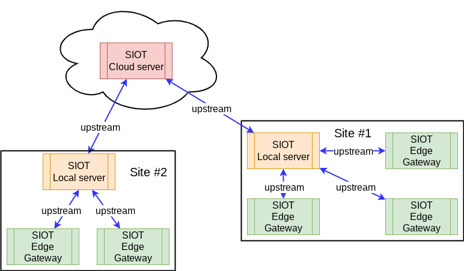
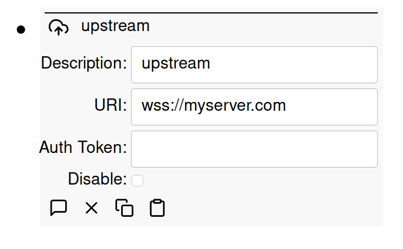

# Synchronization

Simple IoT provides for synchronized upstream connections via NATS or NATS over
WebSocket.



To create an upstream sync, add a sync node to the root node on the downstream
instance. If your upstream server has a name of `myserver.com`, then you can use
the following connections URIs:

- `nats://myserver.com:4222` (4222 is the default NATS port)
- `ws://myserver.com` (WebSocket unencrypted connection)
- `wss://myserver.com` (WebSocket encrypted connection)

IP addresses can also be used for the server name.

Auth token is optional and needs to be
[configured in an environment variable](configuration.md) for the upstream
server. If your upstream is on the public internet, you should use an auth
token, or better, a [device credential](#device-credentials), which limits each
device to its own data and can be revoked on its own. If both devices are on an
internal network, then you may not need either and you can connect without any
authentication.

Typically, `wss` are simplest for servers that are fronted by a web server like
Caddy that has TLS certs. For internal connections, `nats` or `ws` connections
are typically used.

Occasionally, you might also have edge devices on networks where NATS outgoing
connections on port 4222 are blocked. In this case, it's handy to be able to use
the `wss` connection, which just uses standard HTTP(S) ports.



## How synchronization behaves

Synchronization works by replicating the JetStream streams that store each
instance's data — see the [synchronization reference](../ref/sync.md) for how
this works. The behavior you will observe:

- **First connect:** the device announces itself and appears under the upstream
  root node; its full tree (structure, configuration, and history) then arrives
  through replication. Configuration written on the upstream for a device that
  has not connected yet is delivered on first connect.
- **Offline changes catch up.** Changes made on either side while the connection
  is down are delivered when it comes back — replication resumes exactly where
  it left off, and only missed data is sent. See
  [Queuing while offline](#queuing-while-offline) below.
- **Both sides can edit.** Configuration can be changed on either instance; the
  newest change wins everywhere.
- **Deleting a device on the upstream detaches it.** The device keeps running
  standalone and does not add itself back; undelete the device node on the
  upstream to resume synchronization.

## Queuing while offline

An edge instance does not need its upstream to keep working. It writes every
point to its own local store first, and the sync client replicates that store
upstream. When the connection drops, the instance keeps collecting data, running
rules, and accepting local configuration changes, all of which queue on disk.

On reconnect:

- The backlog is sent in order, with the original timestamps, so history
  upstream has no gap.
- Only the missed messages are sent. Replication resumes at the position it
  reached before the outage, which keeps the recovery cheap on a metered or low
  bandwidth link.
- Clients that act on current values (rules, protocol clients, the UI) see one
  update per changed value once the backlog drains rather than a replay of every
  intermediate reading, so a device coming back online does not re-trigger rules
  on stale data.
- History consumers still receive every point. A Db client feeding a time-series
  database reads the stream with its own durable consumer, so the backlog
  reaches the database as well.

Configuration written upstream while a device is offline, or before it has ever
connected, waits and is delivered on the next connect.

How long a device can be offline and still catch up in full depends on how much
history the store keeps. The default is 20,000 points per value, which is
adjustable per instance. See [Store](../ref/store.md#retention-and-durability)
for the setting, and the [synchronization reference](../ref/sync.md) for how the
queuing works.

## Schema

The configuration of a sync node:

```yaml
nodes:
  - sync:
      authToken: your-auth-token
      description: Cloud
      disabled: 0
      uri: wss://myserver.com
```

`uri` is the upstream connection, written as one of the forms described above.
`authToken` matches `SIOT_AUTH_TOKEN` on the upstream server. Leave it out to
connect with the instance's [device key](#device-credentials) instead; the
client then writes the public key on the node as `pubKey`, which is why an
export of a running node carries one.

A sync node belongs on the root node of the downstream instance, so a file that
carries one leaves `parent` out and it attaches to the device node this instance
runs as.

An export carries `authToken` as it was entered, so treat a file that contains
sync nodes the way you would treat the token itself.

The count of synchronizations is a point the client maintains, so an export of a
running node carries it as well.

The client also maintains `txBytes` and `rxBytes`, the total bytes sent to and
received from the upstream. These count at the network socket, so they include
TLS, NATS protocol, and reconnect traffic, which is useful when estimating
cellular data usage. The totals continue across restarts and update every
`bytesReportPeriod` seconds, once an hour when it is not set. `txBytesReset` and
`rxBytesReset` start each one over. Enrollment requests are not included.

The client sets `online` to 1 while the upstream connection is up and to 0 when
it drops, so the point's time is when the connection last changed. The sync node
shows this as its status, and it can be graphed like any other point.

## Device credentials

Every instance has a device key, generated the first time it starts and kept in
`device.nkey` under `SIOT_DATA`. The key is the instance's identity when it
connects to an upstream: a sync node with no `authToken` signs the upstream's
connection challenge with it, so the secret never leaves the device, and only
the server process reads the file. The public half is shown on the sync node as
`pubKey`, and `siot key show` prints it.

A sync node may also carry `caCert`, a PEM certificate the upstream's TLS chain
has to be signed by. With it set, the device accepts only an upstream whose
certificate chains to that one, whatever the system certificate store says.
Leave it out to trust the system store.

An upstream accepts a device key when a `deviceCred` node under the device's
node carries the matching `pubKey`. The credential limits the connection to that
one device: it can push its own data and pull the configuration written for it,
and nothing else. A device cannot publish as another device or read another
device's configuration, and the upstream holds only public keys, so an export or
a copy of its store gives away nothing that could impersonate a device. The
[security reference](../ref/security.md#nats) lists exactly what a credential
allows.

Revoking access is one action: disable the credential (or delete it, or delete
the device node) and the upstream closes the device's connection and refuses it
from then on. Nothing else in the fleet is affected. The device keeps running on
its own, shows `credential refused by upstream` on its sync node, and tries
again every minute, so re-enabling the credential brings it back with everything
it queued while it was out.

The upstream records `lastConnect` and `connected` on each credential, and sets
`online` on the device node to 1 while any of its credentials is connected and
to 0 once none is. The device editor shows this as the device's status, with
when it came online or went offline. The point replicates down to the device as
well, where its own root node does not show it. After the upstream starts, a
device that was online has two minutes to reconnect before it is marked offline,
so a restart does not mark the whole fleet as dropped. `siot cred list` shows
every credential with its device and state; `siot cred disable ID`,
`siot cred enable ID`, and `siot cred rm ID` change one, and
`siot cred add -device ID -pubKey KEY` enrolls a key by hand for a device node
that already exists. All of the `siot cred` commands take the usual
`-natsServer` and `-token` options, so they work against a remote upstream.

There are two ways to get a device connected. Pick one per fleet.

### 1. SIOT_AUTH_TOKEN

The simplest setup is one shared token: set `SIOT_AUTH_TOKEN` on the upstream
and put the same value in `authToken` on every device's sync node. Nothing has
to be created per device. The trade-off is that the token grants full access to
the upstream, so every device can read and write everything, and locking one
device out means changing the token everywhere. This suits a handful of devices
on a private network. For a fleet on the public internet, use enrollment.

### 2. Devices that enroll themselves

Every instance generates its own key on first start, and an _enrollment token_
lets it ask the upstream for a credential for that key. Nothing is copied by
hand in either direction, and the device's node appears on the upstream on its
own:

1. On the upstream, set `SIOT_AUTH_TOKEN` and `SIOT_DEVICE_AUTH=required` (or
   start it with `siot serve -deviceAuth required`). The upstream then accepts
   the shared token only from its own host, where its own client and the `siot`
   commands use it, and every remote connection needs a credential. Enrollment
   does not use the shared token, so nothing below depends on it. See
   [configuration](configuration.md#environment-variables).
2. On the upstream, add an **Enrollment token** node under the root, or under
   the group the devices belong to, and press **Generate token**; or run
   `siot cred token -description fleet`, where `-parent` names a group by ID or
   description and the default is the root. The token is shown once; only its
   hash is stored. **Auto approve** (`-autoApprove`) skips the approval step,
   and an expiry (`-expires 720h`) limits how long the token works.
3. Put the token on each device's sync node as `enrollToken`, with no
   `authToken`. In an image that is one line in the provisioning file:

   ```yaml
   nodes:
     - sync:
         description: Cloud
         uri: wss://myserver.com
         enrollToken: ETXXXX...
   ```

4. When the upstream refuses the device's key, the device connects with the
   token and that key, which together allow exactly one thing, and asks for a
   credential for it. The upstream creates the device node if it is new, under
   the node the token sits in, and a credential under it marked **pending
   approval**; the device's sync node says
   `enrollment pending approval on upstream` and keeps trying every minute.
5. Approve the credential: uncheck **Pending** on it, or run
   `siot cred approve ID` (`siot cred list` shows pending ones). The device
   connects on its next try.

A new device is created where its token sits, so one token per group sorts a
fleet as it enrolls. With a group per customer, create a token in **Customer A**
(`siot cred token -parent "Customer A" -description "customer A units"`) and
another in **Customer B**, and put each customer's token in the image for their
units. A unit built from the A image appears under Customer A on first connect,
with its credential pending there.

A token works under the root or a group only, and in one place. A token under a
device or a deleted group, or one mirrored into two groups, enrolls nothing, and
the upstream log says why. Moving a token sends the next new device to its new
place. The token decides only where a device first appears; after that the
device is an ordinary node. Move it to any group you are authorized for, and a
later enrollment, say after a re-flash with a new key, leaves it where it is.

Each credential records the token that created it as `enrolledBy`.
`siot cred list` and the credential view show it with the token's group, so a
pending credential from another group's token stands out before it is approved.

A fleet that already syncs with the shared token moves over the other way round:
enroll every device first, then set `SIOT_DEVICE_AUTH=required`, since a device
still carrying an `authToken` is refused from then on.

Revoking the enrollment token, by disabling or deleting its node, stops new
enrollments and does not affect devices already enrolled. **Auto approve**
covers only a device the enrollment creates. A key for a device node that
already exists, whether it holds a credential or was added by hand before the
unit first connected, is always pending; an approved credential is never
replaced without an operator. At most 100 devices may wait for approval at once,
so a token that has leaked cannot fill the tree.

Users on a device are replicated to the upstream with the rest of the device's
tree, but they sign in on the device only; see
[users and groups](users-groups.md#where-a-user-signs-in).

## Videos

There are also several videos that demonstrate upstream connections:

### [Simple IoT upstream synchronization support](https://youtu.be/6xB-gXUynQc)

<iframe width="791" height="445" src="https://www.youtube.com/embed/6xB-gXUynQc" title="Simple IoT upstream synchronization support" frameborder="0" allow="accelerometer; autoplay; clipboard-write; encrypted-media; gyroscope; picture-in-picture; web-share" allowfullscreen></iframe>

### [Simple IoT Integration with PLC Using Modbus](https://youtu.be/-1PuBoTAzPE)

<iframe width="791" height="445" src="https://www.youtube.com/embed/-1PuBoTAzPE" title="Simple IoT Integration with PLC Using Modbus" frameborder="0" allow="accelerometer; autoplay; clipboard-write; encrypted-media; gyroscope; picture-in-picture; web-share" allowfullscreen></iframe>
