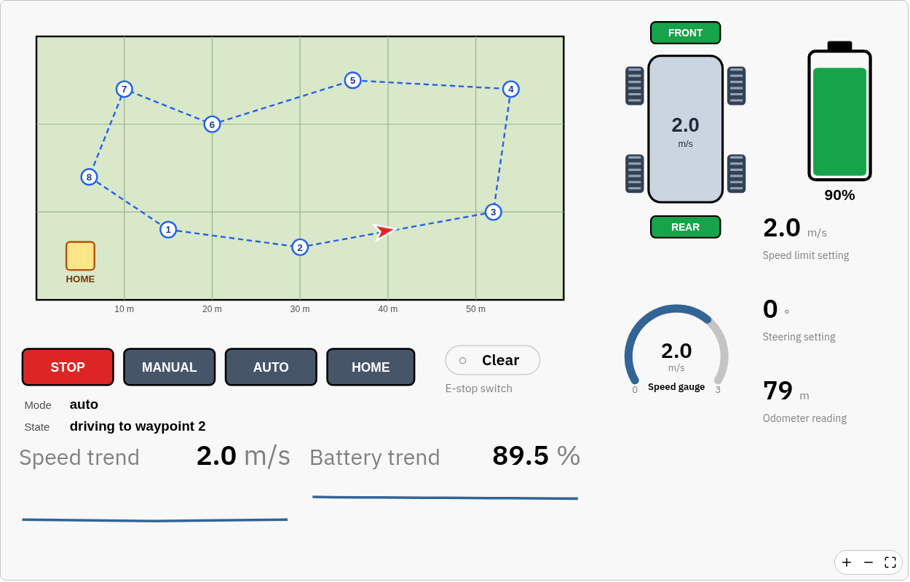

# Autonomous rover

A simulated four-wheel rover drives a mission around a field, reports where it
is and how it is doing, and takes commands from a dashboard. It shows both
directions at once: a Python process on the rover writes status, and people
steer it from the web UI, on site or from the cloud.



## Run it

```
SIOT_AUTH_TOKEN=... python examples/rover/rover.py
```

With [uv](https://docs.astral.sh/uv/), run it from the `python` directory, and
uv installs the package and its dependencies:

```
SIOT_AUTH_TOKEN=... uv run examples/rover/rover.py
```

Add `--isolated --no-project --with simpleiot` after `uv run` to use the
published package instead of the source tree.

The rover sets up its own nodes and dashboard the first time it runs (see
[Setting up the nodes](#setting-up-the-nodes)). Open **Dashboards → Rover
operations** and press **AUTO**. The rover leaves home, follows the numbered
waypoints, and loops until its battery runs low.

When `SIOT_AUTH_TOKEN` is set, sign-in with the default `admin` password is
refused. Set a new one first, as the
[installation guide](https://docs.simpleiot.org/docs/user/installation.html)
describes.

## Things to try

- **MANUAL**, then click the **Steering** slider: the rover drives in an arc at
  the speed limit, turning left of center and right of it, in 5° steps. In the
  other modes the slider follows the wheels, so manual starts from where the
  rover is already steering.
- **FRONT** or **REAR** on the rover drawing turns off that axle. With one axle
  the rover drives at 60% of the limit; with none it stops.
- **E-stop** stops the rover at once, in any mode, until it is cleared.
- **Speed limit setting** changes how fast the rover drives.
- Leave it in **AUTO**: below 20% battery it drives home, charges to 95%, and
  resumes the mission. The battery turns yellow below half and red below a
  quarter, set by `data-siot-bands` in its drawing.

With an [upstream sync](https://docs.simpleiot.org/docs/user/sync.html), the
Rover group and its dashboard reach the cloud instance too. Commands from the
cloud dashboard come down to the rover, and the rover keeps driving its mission
while the link is down.

## Setting up the nodes

The Rover group, its variables, the drawings, and the dashboard are described in
`rover.yaml`. When `rover.py` starts, it hands that file to the server as a
[provisioning](https://docs.simpleiot.org/docs/user/configuration.html#configuration-provisioning)
file and waits until it is applied:

```python
yaml = Path(__file__).with_name("rover.yaml").read_text()
await c.provision("rover.yaml", yaml)
```

1. `provision()` writes the file as a `file` node called `rover.yaml` under the
   **Provisioning** node at the top of the tree, creating that node if needed.
2. The server sees the upload and applies the file the way `siot import` does:
   nodes are matched by description, missing ones are created, and changed
   points are updated. Nothing is deleted.
3. The server records the result on the file node: `provisionHash`, the checksum
   of what it applied, and `error`, empty when it succeeded. `provision()`
   returns once the checksum matches what it uploaded, or raises the error.

The server applies a file again only when its contents change. Restarting the
rover uploads the same contents and changes nothing, while editing `rover.yaml`,
to add a widget for example, updates the dashboard on the next start. Open
**Provisioning → rover.yaml** in the node tree to see what was applied and any
error.

Two things follow from this:

- **Settings belong to people, so the file leaves them out.** The command
  variables carry no value in `rover.yaml`, so applying it again never undoes
  what an operator set. `rover.py` writes a default for any command that has
  never been set.
- **Provisioning stays with its instance.** The server applies files only from
  the Provisioning node under its own root. When the rover syncs to a cloud
  instance, its Provisioning node arrives under the rover's device node, and the
  cloud does not apply it.

To set up the nodes without running the rover, apply the file by hand:
`siot import < examples/rover/rover.yaml`.

## How it works

| File         | What it holds                                                  |
| ------------ | -------------------------------------------------------------- |
| `rover.yaml` | the Rover group, its variables, four drawings, and a dashboard |
| `rover.py`   | the Simple IoT side: setup, commands in, status out, the map   |
| `sim.py`     | the rover's motion, battery, and autonomy, with no SIOT code   |

- **Commands and status are separate variables.** People write `Mode`,
  `Front drive`, `E-stop`, and the settings; only `rover.py` writes `X`,
  `Speed`, `Battery`, `State`, and the rest. The rover never reacts to its own
  writes, and the dashboard shows both what was asked and what is happening. The
  one exception is `Steering command`: outside manual mode `rover.py` sets it to
  the wheel angle, so the slider shows where the autonomy is steering and
  switching to manual does not jerk the wheels.
- **The steering slider is a drawing.** Its knob follows the command with
  `data-siot-translate`, and the track holds a click target every 5° with
  `data-siot-set`. `rover.yaml` also carries a `delete` entry for the value tile
  the slider replaced, so applying it to an older setup removes the tile.
- **Commands arrive through one subscription.** `subscribe_tree()` on the group
  delivers every change, and `rover.py` keeps those for the command nodes,
  loading their current values at start.
- **Status is sent when it changes**, twice a second, which keeps the traffic to
  the cloud small while the rover is parked.
- **The map is drawn by `rover.py`** from its mission and written to the
  `Map drawing` file node, so the route on screen always matches the route the
  rover drives. The marker sits in two nested groups that follow `x` and `y`
  with `data-siot-translate`, and turns with `heading`; see
  [custom drawings](https://docs.simpleiot.org/docs/user/dashboards.html#custom-drawings).

To drive real hardware, replace `Rover` in `sim.py` with something that reads a
GPS and sets motor outputs, and keep `rover.py` as it is.
